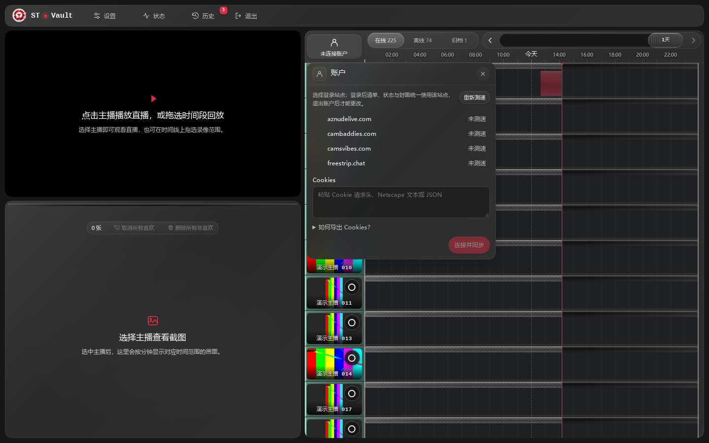
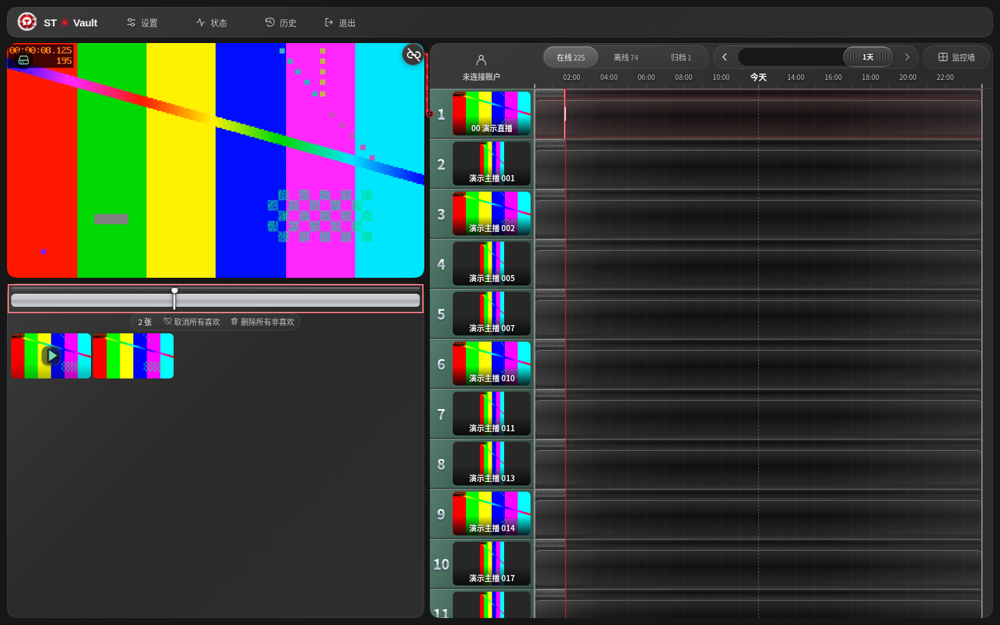

<p align="center">
  
</p>

<h1 align="center">ST-VAULT</h1>

<p align="center"><strong>Your personal live archive</strong></p>
<p align="center">Less scrubbing. More moments worth watching.<br>Record · Replay · Keep</p>

<p align="center"><a href="README.md">简体中文</a> · <strong>English</strong></p>

---

See recent broadcast status, recording coverage and representative images on one timeline. **Find when someone was live, select a recorded range, then use images to jump to the moments that interest you.** Run it on your NAS, watch in your browser and keep your favorites.

[Deploy](#get-started) · [Connect an account](#connect-an-account) · [Get a key](#get-a-key) · [Changelog](docs/CHANGELOG.md#english) · [Docker images](https://hub.docker.com/r/biuzhaoge/st-vault)


Screenshots use synthetic test data.

## Find your moments in a full broadcast

**Sync the broadcasters you follow.** Connect your Stripchat following list instead of adding everyone manually. Name changes are recorded automatically, and existing recordings remain browsable after you unfollow.



**Live and replay in the same workspace.** Click a cover to watch a public stream. Enable automatic recording to save the highest available source quality. Select a recorded range and click an image to jump into it. Short gaps remain visible and long gaps are compressed. Hover over a thumbnail to see its recording's start and end times.

**Skip dates without recordings.** Dates follow the deployment time zone. Today stays visible even before its first recording. A past date stays visible if any broadcaster has footage. Empty past dates are skipped so neighboring recorded dates touch. Selection and playback keep the original recording timestamps.

To select a range with the keyboard, focus a broadcaster's recording timeline and press Enter to start with the visible interval. Tab between the start and end handles. Arrow keys move a handle by one second, Shift + Arrow by one minute, and Page Up or Page Down by one hour. Press Enter to replay the footage in that interval, or Escape to cancel.



**Play and favorite screenshots.** Click once and the thumbnail shrinks slightly, then springs back as playback jumps to that position. Click the same thumbnail again during the rebound and it settles with a small wobble. The pink heart in the upper-left corner toggles and the playhead stays in place. The current thumbnail has a mint play symbol in the center and a soft gradient along the bottom. Press Enter on a focused thumbnail to jump immediately. Favoriting protects the entire recording unit from retention cleanup.

Drag from a thumbnail to select a range. On a touchscreen, press and hold before dragging. Pink outlines mark the thumbnails between the starting point and the pointer, and the toolbar shows the selection count. Hold at the top or bottom edge to continue onto another page. Drag back to shrink the range. Release to flip each selected thumbnail's favorite status. Press Escape to cancel the drag. With keyboard focus on a thumbnail, press F to toggle its favorite or select it with Shift + Space and commit with Enter.

Outside selection mode, “Unlike all” and “Delete unliked” apply to the entire current time range, including other pages. Progress appears in the status panel. Refreshing or closing the browser does not cancel accepted deletion jobs.


## Get started

The public image `biuzhaoge/st-vault:latest` supports **linux/amd64 and linux/arm64**. Docker picks the correct architecture and pulls without a login. Choose either Compose or Docker CLI. Run only one container against a given pair of data directories.

GitHub hosts the source and release notes. Docker Hub distributes verified images. Use a specific version tag to pin a deployment. [GitHub Releases](https://github.com/biuzhaoge/st-vault/releases) · [Image versions](https://hub.docker.com/r/biuzhaoge/st-vault/tags)

### Docker Compose

Save this as `compose.yml` and run the command from the same directory. You can also download the [same template](compose.yml) from the repository.

```yaml
name: st-vault
services:
  app:
    image: biuzhaoge/st-vault:latest
    ports:
      - '10002:10002'
    volumes:
      - ./data:/data
      - ./media:/media
    restart: unless-stopped
    stop_grace_period: 180s
```

```sh
docker compose up -d
```

### Docker CLI

Run this from the deployment directory on your NAS or Linux host. Recordings and settings will go into the local `media` and `data` directories.

```sh
docker run -d --name st-vault --restart unless-stopped \
  -p 10002:10002 --stop-timeout 180 \
  -v "$PWD/data:/data" -v "$PWD/media:/media" \
  biuzhaoge/st-vault:latest
```

Open `http://NAS-address:10002` after starting, or <http://127.0.0.1:10002> on the host. HTTP sends PINs, sessions, and credentials in plaintext. The default port mapping listens on all host interfaces. Use your firewall to limit access to a trusted LAN, and keep port 10002 off the public internet. Use your own VPN if you need remote access.

### Change settings as needed

- **Port.** If the port is in use, change the left side of `10002:10002`, for example to `10003:10002`.
- **Storage.** `data` holds settings, credentials, and the `postgres` database directory. `media` holds recordings and the portable library. Edit their host paths as needed. PostgreSQL requires a local filesystem. On Windows Docker Desktop, place `data` on the WSL Linux filesystem or mount a local Docker volume at `/data/postgres` as described in the [storage guide](docs/CONTRIBUTING.en.md#postgresql-storage).
- **Time zone and version.** The default time zone is `Asia/Shanghai`. To change it, add `TZ: America/New_York` under Compose `environment` or pass `-e TZ=America/New_York` to Docker. Replace `latest` with `0.1.1` to pin this release.
- **Empty-date cleanup.** By default, the archive clears broadcaster status history, historical events, recording coverage summaries, and completed program runs wholly inside the skipped period. Set `STV_CLEAN_EMPTY_DAYS=0` to retain this history while still skipping empty dates on the timeline.
- **Use an existing reverse proxy.** Join the app and proxy to the same Docker network. Point the proxy at the app's network name or alias on port `10002`. Omit `ports` if all access goes through the proxy.

The stop timeout gives recording and PostgreSQL time to finish writing. Keep your existing `data` and `media` paths and any database volume you have configured when upgrading.

Set a six-digit PIN on first visit. If the startup screen reports a connection failure, select **Reconnect** once the network is available. Connect an account from the workbench, and import a key before playing an encrypted stream. If a live connection times out, open the player's CDN menu to test actual download speeds and select a node. Changing nodes reconnects all live streams and recordings immediately and may cause a short interruption.

The workbench uses a landscape layout. The browser viewport must be at least 744 × 600 CSS pixels and no wider than 21:9. Phones, portrait tablets, and undersized split windows show a display-size prompt. On touchscreens, swipe vertically to scroll the broadcaster list or page through screenshots, and drag horizontally on a timeline to select a range.

The Status panel uses color to distinguish healthy, running, warning, and error states. Hover over or focus a row's info icon to learn what the task does, when it runs, and which settings apply. The full storage bar represents total capacity. The filled section shows used space, and the unfilled section and text show free space. Affected rows offer **Retry** when the app can recheck or resume the work. Replace expired cookies in Account. Address read-only or full disks before retrying storage.

## Connect an account

1. Choose a site in the Account panel, then sign in to the same domain in your browser.
2. Open Cookie-Editor in the signed-in tab and select **Export → JSON**.
3. Paste the full JSON array into the Account panel and select **Connect and sync**. To change domains, disconnect the existing account before importing cookies from the new domain. [Cookie-Editor](https://cookie-editor.com/)


## Get a key

Choose a matching entry in the public key list. Its JSON property name is the `pkey` and its value is the `pdkey`. Open the player's key panel, paste the pair in `pkey:pdkey` format with an ASCII colon, and add it. Upstream keys can rotate, so check the panel's validation result. [Public key list](https://github.com/kesamom/stripchat_mouflon/blob/main/stripchat_mouflon_keys.json) · [Community discussion](https://github.com/lossless1024/StreaMonitor/issues/359)

The panel displays the saved name and value on separate lines. Scroll a long value horizontally to view it in full.

The key setup draws on two third-party projects. [StripchatRecorder](https://github.com/ChanTrail/StripchatRecorder/blob/master/README.en.md#mouflon-hls-decryption-keys) · [scp-standalone](https://github.com/aitschti/scp-standalone#files)

## Backups, recovery and updates

Stop the container before backing up all of `data` (including `postgres`), `media`, and the deployment configuration. Include the PostgreSQL volume if you use a separate mount. Keep the matching image. To update in place with Compose, keep the existing mounts and run `docker compose pull && docker compose up -d`. Migrating only `media` can rebuild the media index and requires setting up the PIN, account and key again. [Storage guide](docs/CONTRIBUTING.en.md#postgresql-storage)

## Boundaries

- Only publicly accessible streams are supported. The project does not unlock private/paid content or replace the site's human verification.
- Account access uses cookies exported from your browser; status and media retrieval are anonymous.
- Replay requires locally saved media. Network issues, missing upstream segments and resource constraints can leave gaps that cannot be reconstructed.
- Recordings preserve the source without improving its quality. Screenshots use background software decoding and catch up when queued; there is no GPU dependency.
- One administrator may use multiple clients. A library has one writer instance. Deletion is irreversible; keep backups.

[Architecture and storage](docs/architecture.en.md) · [API](docs/api.en.md) · [Maintenance guide](docs/CONTRIBUTING.en.md)

## Rights and disclaimer

ST-Vault is independent of Stripchat and its operators, with no affiliation or endorsement. Access, save and use only content you are authorized to use, respecting applicable law, site terms, privacy and content rights. Access does not grant redistribution rights.

Original code is licensed under [Apache-2.0](LICENSE); third-party components retain [their own licenses](docs/third-party.en.md). The software is provided as is, without guarantees of uninterrupted operation or protection against data loss. Protect your sessions, access endpoints and backups; see the [security policy](docs/SECURITY.en.md).
