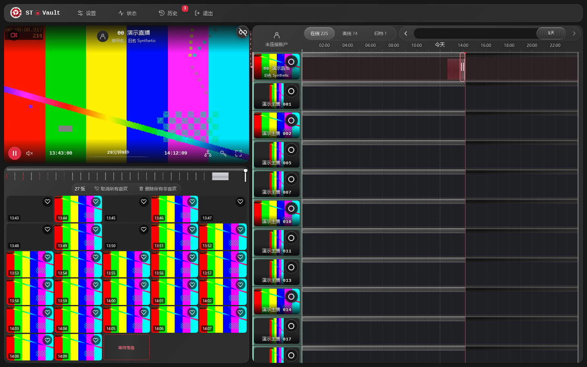
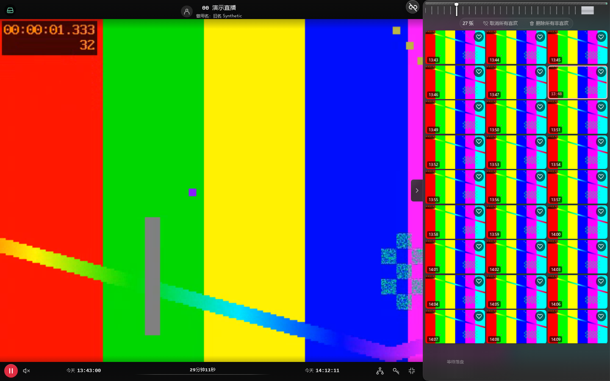
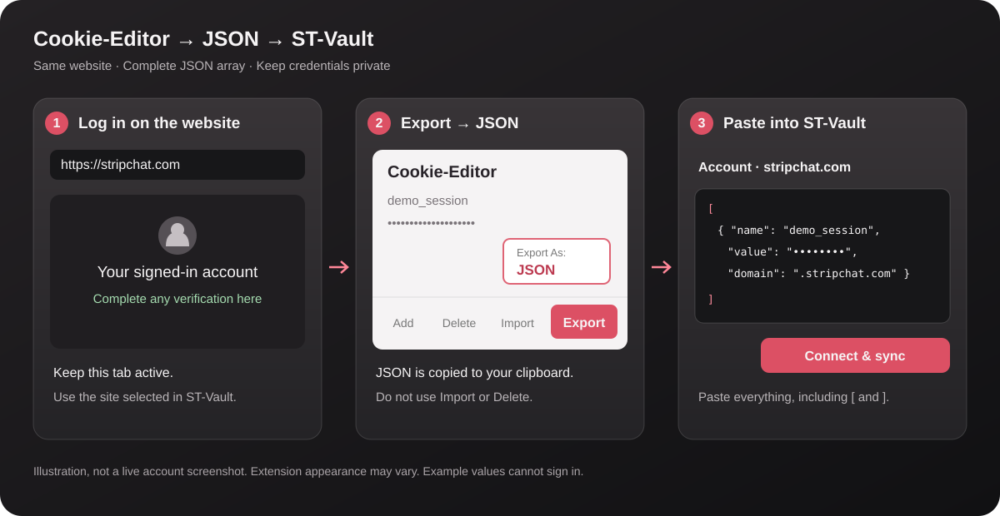

<p align="center">
  
</p>

<h1 align="center">ST-VAULT</h1>

<p align="center"><strong>Your personal live archive</strong></p>
<p align="center">Less scrubbing. More moments worth watching.<br>Record · Replay · Keep</p>

<p align="center"><a href="README.md">简体中文</a> · <strong>English</strong></p>

---

See recent broadcast status, recording coverage and representative images on one timeline. **Find when someone was live, select a recorded range, then use images to jump to the moments that interest you.** Run it on your NAS, watch in your browser and keep your favorites.

[Deploy](#get-started) · [Connect an account](#connect-an-account) · [Get a key](#get-a-key) · [Changelog](docs/CHANGELOG.md#english) · [Docker images](https://hub.docker.com/r/biuzhaoge/st-vault)



Screenshots use synthetic test data.

## Find your moments in a full broadcast

**Sync the broadcasters you follow.** Connect your Stripchat following list instead of adding everyone manually. Name changes are recorded automatically, and existing recordings remain browsable after you unfollow.


**Live and replay in the same workspace.** Click a cover to watch a public stream. Enable automatic recording to save the highest available source quality. Select a recorded range and click an image to jump into it; short gaps remain visible, while long gaps are compressed.


**Keep the moments you like.** A heart protects the corresponding complete recording unit from retention cleanup. The toolbar offers “Unlike all” and “Delete unliked” for the entire current time range, including other pages; use each thumbnail’s heart to toggle its favorite. Progress appears in the status panel; refreshing or closing the browser does not cancel accepted deletion jobs.



## Get started

The public image `biuzhaoge/st-vault:latest` supports **linux/amd64 and linux/arm64**. Docker picks the correct architecture and pulls without a login. Choose either Compose or Docker CLI. Run only one container against a given pair of data directories.

GitHub hosts the source and release notes. Docker Hub distributes verified images. Use a specific version tag to pin a deployment. [GitHub Releases](https://github.com/biuzhaoge/st-vault/releases) · [Image versions](https://hub.docker.com/r/biuzhaoge/st-vault/tags)

### Docker Compose

Save this as `compose.yml` and run the command from the same directory. You can also download the [same template](compose.yml) from the repository.

```yaml
name: st-vault
services:
  app:
    image: biuzhaoge/st-vault:latest
    ports:
      - '127.0.0.1:10002:10002'
    volumes:
      - ./data:/data
      - ./media:/media
    mem_limit: 2g
    init: true
    restart: unless-stopped
    stop_grace_period: 180s
    logging: { driver: local }
```

```sh
docker compose up -d
```

### Docker CLI

Run this from the deployment directory on your NAS or Linux host. Recordings and settings will go into the local `media` and `data` directories.

```sh
docker run -d --name st-vault --restart unless-stopped \
  -p 127.0.0.1:10002:10002 --memory 2g \
  -v "$PWD/data:/data" -v "$PWD/media:/media" \
  --init --stop-timeout 180 --log-driver local \
  biuzhaoge/st-vault:latest
```

### Change settings as needed

- **LAN access.** The default URL is <http://127.0.0.1:10002>. For direct access from a trusted LAN, replace `127.0.0.1` in `ports` or `-p` with the NAS's private IP. To change the port, edit only the host side.
- **Storage.** In `volumes` or `-v`, edit the host path before the colon. The `data` directory stores PostgreSQL and private settings and works best on a local SSD. Store `media` on a larger drive if needed.
- **Memory limit.** Start with `2g`. Raise `mem_limit` or `--memory` if concurrent recordings regularly approach that limit.
- **Time zone and version.** The default time zone is `Asia/Shanghai`. To change it, add `TZ: America/New_York` under Compose `environment` or pass `-e TZ=America/New_York` to Docker. Replace `latest` with `0.1.0` to pin this release.

For access via a domain name or public IP, use an HTTPS reverse proxy that preserves the original Host and supports SSE. Set `STV_SECURE_COOKIE=1` if you need to explicitly enable HTTPS proxy mode.

When upgrading, keep your existing `data` and `media` paths, custom ports, environment options, and runtime UID/GID. The stop timeout gives embedded PostgreSQL time to close cleanly. The `local` logging driver rotates container logs.

Set a six-digit PIN on first visit. Connect an account from the workbench, and import a key before playing an encrypted stream. If a live connection times out, open the player's CDN menu to test actual download speeds and select a node. Changing nodes reconnects all live streams and recordings immediately and may cause a short interruption.

Affected rows in the Status panel offer **Retry** when the app can recheck or resume the work in the background. Replace expired cookies in Account. Address read-only or full disks before retrying storage.

## Connect an account

1. Choose a site in the Account panel, then sign in to the same domain in your browser.
2. Open Cookie-Editor in the signed-in tab and select **Export → JSON**.
3. Paste the full JSON array into the Account panel and select **Connect and sync**. To change domains, disconnect the existing account before importing cookies from the new domain. [Cookie-Editor](https://cookie-editor.com/)



## Get a key

Choose a matching entry in the public key list. Its JSON property name is the `pkey` and its value is the `pdkey`. Open the player's key panel, paste the pair in `pkey:pdkey` format with an ASCII colon, and add it. Upstream keys can rotate, so check the panel's validation result. [Public key list](https://github.com/kesamom/stripchat_mouflon/blob/main/stripchat_mouflon_keys.json) · [Community discussion](https://github.com/lossless1024/StreaMonitor/issues/359)

The key setup draws on two third-party projects. [StripchatRecorder](https://github.com/ChanTrail/StripchatRecorder/blob/master/README.en.md#mouflon-hls-decryption-keys) · [scp-standalone](https://github.com/aitschti/scp-standalone#files)

## Backups, recovery and updates

Stop the container before backing up the complete `data`, `media` and deployment configuration. Keep the matching image. To update with Compose, run `docker compose pull && docker compose up -d`. Migrating only `media` can rebuild the media index and requires setting up the PIN, account and key again. [Maintenance guide](docs/CONTRIBUTING.en.md)

## Boundaries

- Only publicly accessible streams are supported. The project does not unlock private/paid content or replace the site's human verification.
- Account access uses cookies exported from your browser; status and media retrieval are anonymous.
- Replay requires locally saved media. Network issues, missing upstream segments and resource constraints can leave gaps that cannot be reconstructed.
- Recordings preserve the source without improving its quality. Screenshots use background software decoding and catch up when queued; there is no GPU dependency.
- One administrator may use multiple clients. A library has one writer instance. Deletion is irreversible; keep backups.

[Architecture and storage](docs/architecture.en.md) · [API](docs/api.en.md) · [Maintenance guide](docs/CONTRIBUTING.en.md)

## Rights and disclaimer

ST-Vault is independent of Stripchat and its operators, with no affiliation or endorsement. Access, save and use only content you are authorized to use, respecting applicable law, site terms, privacy and content rights. Access does not grant redistribution rights.

Original code is licensed under [Apache-2.0](LICENSE); third-party components retain [their own licenses](docs/third-party.en.md). The software is provided as is, without guarantees of uninterrupted operation or protection against data loss. Protect your sessions, access endpoints and backups; see the [security policy](docs/SECURITY.en.md).
