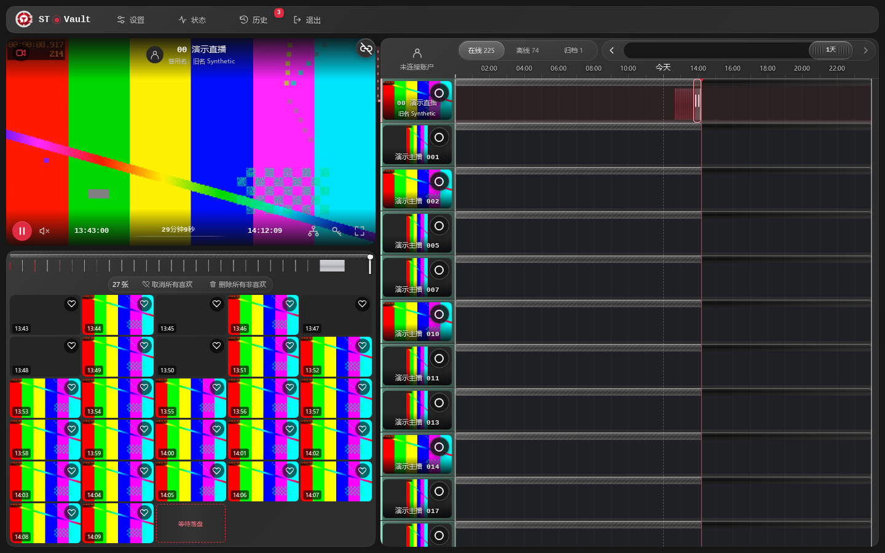
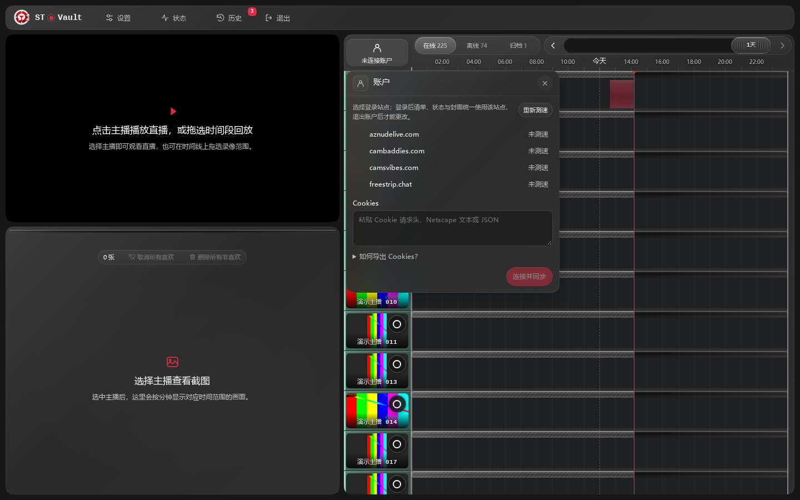
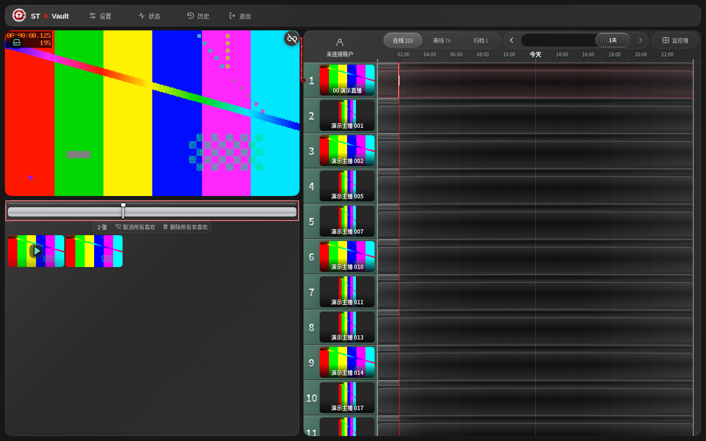
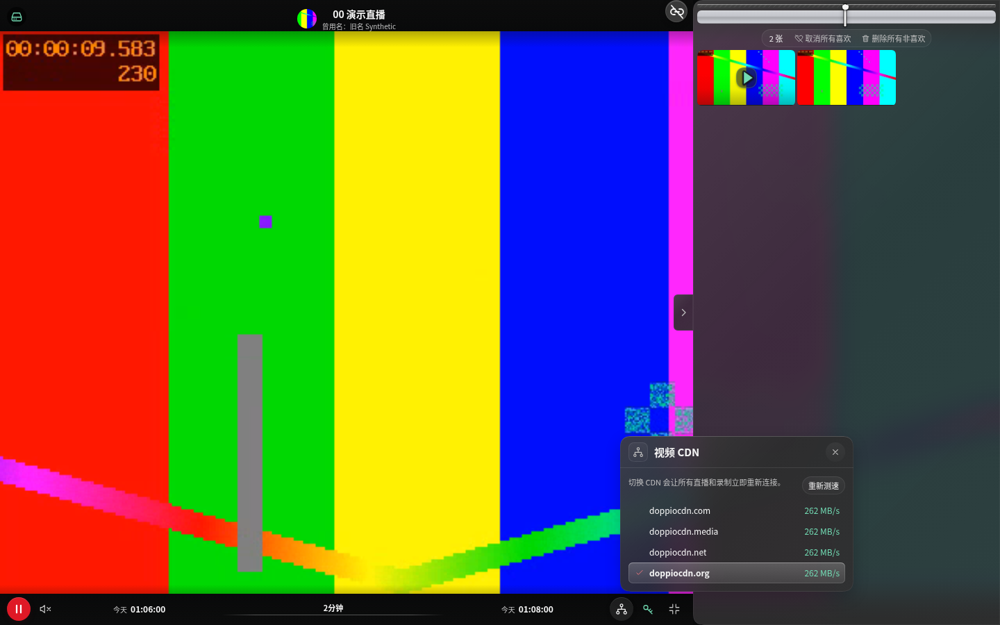
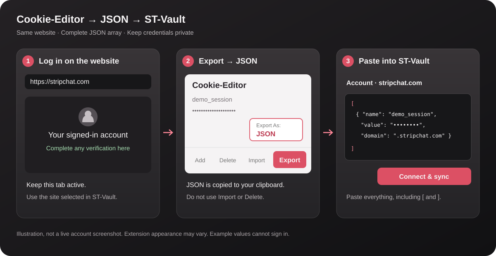

<p align="center">
  
</p>

<h1 align="center">ST-VAULT</h1>

<p align="center"><strong>你的直播时光库</strong></p>
<p align="center">少拖进度条，多看你想看的时刻。<br>记录 · 回看 · 收藏</p>

<p align="center"><strong>简体中文</strong> · <a href="README.en.md">English</a></p>

---

把主播最近的播出状态、录制覆盖和代表截图放在同一张时间线上。**先看什么时候播过，再划出有画面的范围，通过截图定位你感兴趣的高光。** 部署在自己的 NAS，用浏览器看直播、回顾录像，把喜欢的片段留下。

[开始部署](#开始部署) · [连接账户](#连接账户) · [获取密钥](#获取密钥) · [更新日志](docs/CHANGELOG.md) · [Docker 镜像](https://hub.docker.com/r/biuzhaoge/st-vault)



示例画面使用合成测试数据。

## 从一场直播，找到想看的那一段

**同步喜欢的主播。** 连接 Stripchat 账户的关注列表，免去逐个手动添加。名称变化自动记录曾用名，取关后仍可浏览已有录像。



**直播与回看在同一面板。** 点击封面直接看公开直播，开启自动录制后保存最高可用源画质。拖选录到的范围，再点截图跳到对应画面；短空档留白，长空档压缩。鼠标悬停在截图上可查看对应录像的起止时间。

**跳过无录像日期。** 日期按部署时区计算。当天始终保留，即使还没有录像。已结束的一天只要有任意主播的录像画面，就会保留在时间线上。全库无录像的历史日期会跳过，两侧日期直接相接，拖选和播放仍使用原来的录制时间。

用键盘取段时，聚焦主播的录制时间线，按 Enter 从当前可见时段开始。用 Tab 切换起点和终点。方向键每次调整一秒，按住 Shift 每次调整一分钟，Page Up / Page Down 每次调整一小时。再按 Enter 回看所选时段的录像，或按 Esc 取消。



**用截图回看和收藏。** 轻点一下，截图会微微缩小再回弹，随后跳到对应位置播放。趁回弹时再点同一张，画面会轻晃一下回到原位，左上角的粉红爱心随收藏状态出现或收起，播放位置保持不动。正在播放的截图中央有薄荷绿播放标记，底部有淡渐变。聚焦截图后按回车可立即跳播。收藏会保护对应的完整录像单元，保留天数清理会跳过它。

按住鼠标拖过截图，或在触屏上长按后拖动。粉红轮廓标出起点和当前位置之间的截图，工具栏显示已选数量。将指针停在截图区上沿或下沿可跨页继续选，拖回时选区随之缩小。松手后逐张切换收藏状态，已收藏的取消收藏，未收藏的加入收藏。按 Esc 可取消当前拖选。聚焦截图后按 F 可切换收藏，也可用 Shift + 空格选中截图，再按回车提交。

退出选择后，工具栏中的“取消所有喜欢”和“删除所有非喜欢”仍作用于整个当前时间范围，包含其他页。运行进度在状态面板查看，刷新或关闭网页不会中断已接纳的删除任务。



## 开始部署

公开镜像 `biuzhaoge/st-vault:latest` 支持 **linux/amd64 和 linux/arm64**。Docker 会自动选择架构，拉取无需登录。Compose 和 Docker CLI 任选一种，同一组数据目录只供一个容器使用。

GitHub 保存源码和正式发布说明，Docker Hub 提供经验证的镜像。需要固定部署时，可选明确的版本标签。[GitHub 发布](https://github.com/biuzhaoge/st-vault/releases) · [镜像版本](https://hub.docker.com/r/biuzhaoge/st-vault/tags)

### Docker Compose

把下面的内容保存为 `compose.yml`，在同一目录执行启动命令。也可以直接下载仓库里的[同一份模板](compose.yml)。

```yaml
name: st-vault
services:
  app:
    image: biuzhaoge/st-vault:latest
    ports:
      - '10002:10002'
    volumes:
      - ./data:/data
      - ./media:/media
    restart: unless-stopped
    stop_grace_period: 180s
```

```sh
docker compose up -d
```

### Docker CLI

在 NAS 或 Linux 的部署目录执行以下命令。录像和配置会保存在当前目录下的 `media` 和 `data`。

```sh
docker run -d --name st-vault --restart unless-stopped \
  -p 10002:10002 --stop-timeout 180 \
  -v "$PWD/data:/data" -v "$PWD/media:/media" \
  biuzhaoge/st-vault:latest
```

启动后通过 `http://NAS地址:10002` 打开，同机访问用 <http://127.0.0.1:10002>。HTTP 会明文传输 PIN、会话和凭据。默认端口映射会在宿主机各网络接口开放，请通过防火墙限制在可信局域网，避免将 10002 直接暴露到公网。需要远程访问时可使用自己的 VPN。

### 需要时再改参数

- **端口**。如有冲突，将 `10002:10002` 左侧改为其他端口，例如 `10003:10002`。
- **存储位置**。`data` 保存配置、凭据和 `postgres` 数据库目录，`media` 保存录像和可迁移媒体库。可按需修改两个目录的宿主机路径。PostgreSQL 要求本机文件系统。Windows Docker Desktop 请把 `data` 放在 WSL 的 Linux 文件系统，或按维护说明将本地 Docker 卷挂载到 `/data/postgres`。[数据库存储说明](docs/CONTRIBUTING.md#postgresql-存储)
- **时区与版本**。默认时区是 `Asia/Shanghai`。更换时在 Compose 的 `environment` 中添加 `TZ: America/New_York`，或在 CLI 中加 `-e TZ=America/New_York`。将 `latest` 改为 `0.1.1` 可固定此版本。
- **无录像日期清理**。默认自动清理这类日期的主播状态、历史事件、录像覆盖汇总和完全落在空档内的已结束运行记录。设置 `STV_CLEAN_EMPTY_DAYS=0` 可关闭历史清理并继续在时间线跳过空白日。
- **使用已有反向代理**。让应用和代理加入同一个 Docker 网络，在代理中连接应用的网络名称或别名及端口 `10002`。仅通过代理访问时可移除 `ports`。

停机宽限为录制收尾和 PostgreSQL 落盘预留时间。升级时沿用原来的 `data`、`media` 路径及已配置的数据库卷。

首次打开时设置六位 PIN。如果启动页提示连接失败，请在网络恢复后点击「重新连接」。进入工作台后可连接账户，播放加密直播前需导入密钥。直播连接超时时，可在播放器的 CDN 菜单手动测速并选择节点。测速会下载小段媒体作比较。更换节点会让所有直播和录制立即重新连接，期间可能短暂停顿。

工作台使用横向布局。浏览器内容区至少需 744 × 600 CSS 像素，宽高比不得超过 21:9。手机、平板竖屏或过小的分屏窗口会显示尺寸提示。触屏上可上下滑动主播列表、横拖时间线取段、上下滑动截图翻页。

状态面板用颜色区分可用、运行中、警告和异常。悬停或聚焦事项旁的信息图标可查看任务用途、运行方式和适用的当前设置。存储条全长代表总容量，实心部分代表已用空间，空心部分和文字显示剩余空间。支持恢复的异常行会提供「重试」。Cookies 失效时请到「账户」更新。磁盘只读或空间不足时，请先处理存储问题再重试。

## 连接账户

1. 在账户面板选择站点，然后在浏览器登录同一域名。
2. 在已登录的标签页打开 Cookie-Editor，选择 **Export → JSON**。
3. 将完整 JSON 数组粘贴到 ST-Vault 账户面板，点击「连接并同步」。换域名时先断开旧账户，再导入新域名的 Cookies。[Cookie-Editor](https://cookie-editor.com/)



## 获取密钥

从公开密钥列表选择匹配的条目。JSON 属性名是 `pkey`，对应值是 `pdkey`。打开播放器钥匙面板，将一对密钥按 `pkey:pdkey` 格式粘贴并添加，中间使用英文冒号。上游会轮换密钥，请以面板验证结果为准。[公开密钥列表](https://github.com/kesamom/stripchat_mouflon/blob/main/stripchat_mouflon_keys.json) · [社区讨论](https://github.com/lossless1024/StreaMonitor/issues/359)

面板分行显示已保存的密钥名和密钥值。较长的密钥值可横向滚动查看。

密钥配置参考了两个第三方项目。[StripchatRecorder](https://github.com/ChanTrail/StripchatRecorder/blob/master/README.en.md#mouflon-hls-decryption-keys) · [scp-standalone](https://github.com/aitschti/scp-standalone#files)

## 备份恢复与更新

停止容器后备份完整的 `data`（含 `postgres`）、`media` 和部署配置，保留备份对应的镜像。若 PostgreSQL 使用单独的 Docker 卷，也要备份该卷。Compose 更新用 `docker compose pull && docker compose up -d`，沿用原挂载即可原位升级。只迁移 `media` 可以重建媒体索引，PIN、账户和密钥需重新配置。[数据库存储说明](docs/CONTRIBUTING.md#postgresql-存储)

## 使用边界

- 只访问和保存公开可用直播，不解锁私密/付费内容，不代替原站真人验证。
- 账户通过用户浏览器导出的 Cookies 接入；状态和媒体匿名获取。
- 只能回看本地已保存画面，网络、上游缺片、资源不足可能留下空档，无法补回不存在的内容。
- 原流保存，不提升源画质；截图后台软件解码，积压时继续追赶，没有 GPU 依赖。
- 单管理员、多客户端；数据目录由单实例独占，删除不可撤销，请备份。

[架构与存储](docs/architecture.md) · [API](docs/api.md) · [维护说明](docs/CONTRIBUTING.md)

## 权利与免责声明

本项目与 Stripchat 及其运营方无隶属或背书关系。请仅访问、保存和使用已获授权的内容，遵守适用法律、网站条款及相关人员的隐私与内容权利；能够访问不代表可以转载或分发。

原创代码采用 [Apache-2.0](LICENSE)，第三方组件遵循[各自许可](docs/third-party.md)。软件按现状提供，不保证不中断或数据不丢失。会话、访问入口和备份由部署者妥善管理，详见[安全说明](docs/SECURITY.md)。
